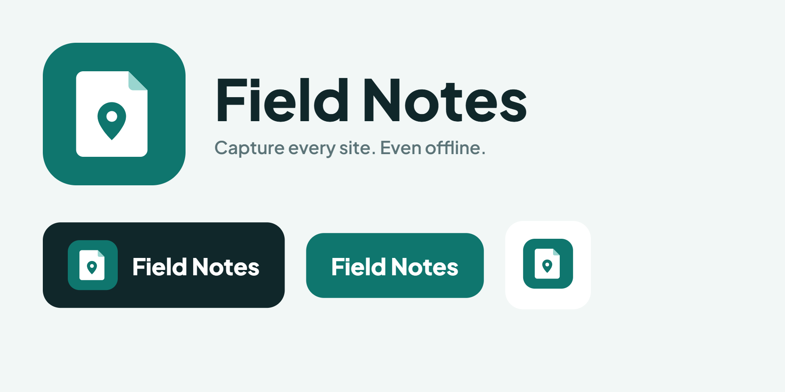
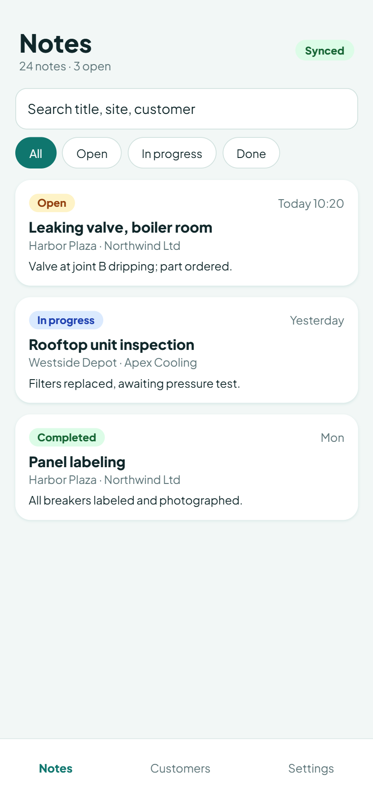
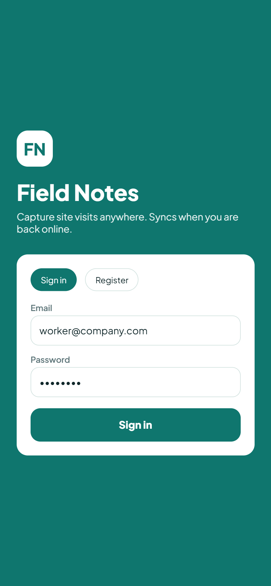
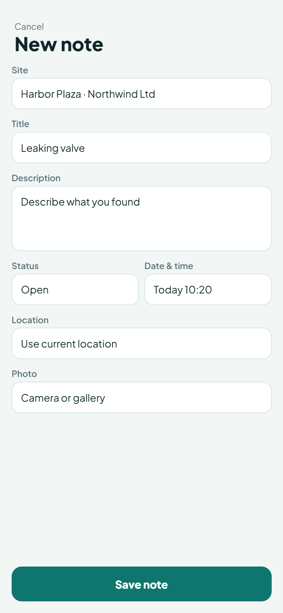
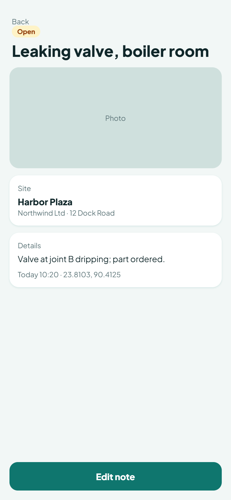
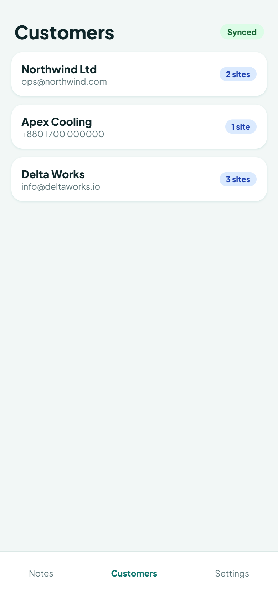
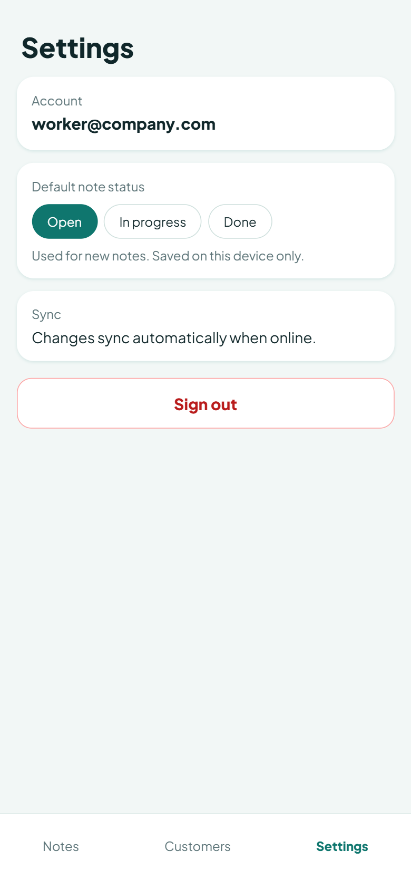

# Field Notes

<p align="center">
  
</p>

<p align="center"><strong>Capture every site. Even offline.</strong></p>

<p align="center">
  <a href="docs/demo/field-notes-demo.mp4">Demo video</a> ·
  <a href="https://youtu.be/3YPGbu-IQuc">YouTube</a> ·
  <a href="https://github.com/akhlak007/field-notes/releases/tag/v1.0">APK Release</a> ·
  <a href="https://field-notes-3.onrender.com/api/health">Live API</a> ·
  <a href="docs/ARCHITECTURE.md">Architecture</a> ·
  <a href="docs/API.md">API reference</a>
</p>

An offline-first mobile app for recording field observations during site visits. Customers, sites, and notes are written to local SQLite immediately and synchronized with a Spring Boot API whenever connectivity is available.

> [!IMPORTANT]
> The free Render service can take **30–60 seconds** to wake after being idle. Open the [health endpoint](https://field-notes-3.onrender.com/api/health) first and wait for `{"status":"UP"}` before evaluating the app.

## Evaluating this project in 3 minutes

1. Open the [live API health endpoint](https://field-notes-3.onrender.com/api/health) to wake the backend.
2. Install [`FieldNotes-v1.0.apk`](https://github.com/akhlak007/field-notes/releases/download/v1.0/FieldNotes-v1.0.apk) from the [GitHub Release](https://github.com/akhlak007/field-notes/releases/tag/v1.0) and register a new account.
3. Create a customer → site → note.
4. Enable airplane mode and edit the note; the change is saved locally.
5. Reconnect and watch the pending count return to zero and **Last synced** update.
6. Open **Settings → Default note status**, change it, restart the app, and confirm it persists.

### Install the Android APK

**Release:** [Field Notes v1.0](https://github.com/akhlak007/field-notes/releases/tag/v1.0) — `FieldNotes-v1.0.apk` (65.0 MB / 68,160,943 bytes). SHA-256: `37BA934255C8E1BD160E30C5BB9D71A936048EE814DB4405F8587F64581B4573`.

1. Download [`FieldNotes-v1.0.apk`](https://github.com/akhlak007/field-notes/releases/download/v1.0/FieldNotes-v1.0.apk) from the Release.
2. If Android asks, allow installs from unknown sources for your browser or file manager.
3. Install and open Field Notes.
4. Select **Register** to create an evaluator account.

## Features

- Register / sign in with JWT; data is isolated per account (foreign IDs return 404)
- Customers → sites → notes, stored as foreign keys only (names come from JOINs)
- Create, edit, and delete while offline; auto-sync when the network returns
- Search notes by title, description, site, or customer; filter by status and site
- Photo (camera or gallery) and current location, with a non-crashing denied path
- Default note status in Settings — saved on this device only, never synced
- Restore after clear-data / reinstall by signing in again (pull from epoch)

## Demo

<p align="center">
  <a href="docs/demo/field-notes-demo.mp4">
    
  </a>
</p>

<p align="center">
  <strong><a href="docs/demo/field-notes-demo.mp4">▶ Play the demo video (MP4, 24 MB)</a></strong><br />
  <a href="https://youtu.be/3YPGbu-IQuc">Watch on YouTube</a>
</p>

The written [demo walkthrough](docs/DEMO.md) covers registration, relational CRUD, search and filtering, offline changes, automatic synchronization, and server restore.

## Screenshots

<table>
  <tr>
    <th>Sign in</th>
    <th>Notes</th>
    <th>New note</th>
  </tr>
  <tr>
    <td></td>
    <td></td>
    <td></td>
  </tr>
  <tr>
    <th>Note detail</th>
    <th>Customers</th>
    <th>Settings</th>
  </tr>
  <tr>
    <td></td>
    <td></td>
    <td></td>
  </tr>
</table>

## Architecture

```
Widget → BLoC → Repository → local SQLite (Drift) → SyncService → REST API
```

Local SQLite is the UI source of truth. Sync is **push pending rows, then pull since a per-user cursor** (`last_sync_at:<userId>`). Details: [docs/ARCHITECTURE.md](docs/ARCHITECTURE.md), [docs/SYNC.md](docs/SYNC.md), [docs/API.md](docs/API.md).

The mobile app uses feature-based presentation with BLoC state management, repositories for local-first persistence, and a dedicated synchronization service. The backend separates controllers, services, repositories, security, DTOs, and relational entities.

## Tech stack

| Side | Stack |
|---|---|
| Mobile | Flutter, BLoC, Drift/SQLite, Dio, SharedPreferences |
| Backend | Java 17, Spring Boot 3.5, Spring Security + JWT, JPA, Flyway, PostgreSQL 16 |

## Deployment (public HTTPS + APK)

Target: **PostgreSQL on Neon** + **Spring Boot on Render** (Docker) + release APK compiled with the Render URL.

| Item | Value |
|---|---|
| **Live backend URL** | `https://field-notes-3.onrender.com` |
| **Health** | `GET https://field-notes-3.onrender.com/api/health` → `{"status":"UP"}` |
| **APK** | [`FieldNotes-v1.0.apk`](https://github.com/akhlak007/field-notes/releases/download/v1.0/FieldNotes-v1.0.apk) (65.0 MB). SHA-256: `37BA934255C8E1BD160E30C5BB9D71A936048EE814DB4405F8587F64581B4573`. |
| **Video demo** | [Play MP4](docs/demo/field-notes-demo.mp4) · [Watch on YouTube](https://youtu.be/3YPGbu-IQuc) |
| **Demo access** | Create an account from the Register tab; no shared credentials are required |
| **Wake-up** | Render **free** web services sleep after ~15 minutes idle and can take **30–60 seconds** to wake. The first request is slow; it is not a crash. Check [Render pricing](https://render.com/pricing) for current free-tier terms. |

Render env vars (never commit the real values):

| Name | Example |
|---|---|
| `SPRING_PROFILES_ACTIVE` | `prod` |
| `PORT` | `8080` |
| `SERVER_ADDRESS` | `0.0.0.0` |
| `DB_URL` | `jdbc:postgresql://<neon-host>/<db>?sslmode=require` |
| `DB_USER` | Neon user |
| `DB_PASSWORD` | Neon password |
| `JWT_SECRET` | output of `openssl rand -base64 48` (32+ bytes) |
| `PHOTO_DIR` | `/app/uploads` |

Photos are files under `PHOTO_DIR`. On free Render disks they **disappear when the instance restarts**. Notes and other data stay in Neon. CORS is off; a mobile app does not need it.

Flyway applies the database schema automatically on the first successful backend boot against Neon.

Release APKs use HTTPS only (`usesCleartextTraffic` is not set on the main manifest). A local release keystore can be configured with `mobile/android/key.properties`; this file and all keystores are ignored by Git.

### LAN fallback (your phone on home Wi-Fi)

Use a **debug** build; release blocks arbitrary LAN HTTP:

```powershell
docker compose up --build
cd mobile
flutter run --dart-define=API_BASE_URL=http://192.168.x.x:8080
```

## Run locally

**Docker (database + API):**

```bash
docker compose up --build
```

API: `http://localhost:8080` — `GET /api/health` should return `{ "status": "UP" }`.

**Without Docker for the API** (Postgres still from Compose):

```powershell
docker compose up -d db
cd backend
.\mvnw.cmd spring-boot:run
```

```bash
docker compose up -d db
cd backend
./mvnw spring-boot:run
```

| Variable | Default |
|---|---|
| `PORT` | `8080` |
| `SERVER_ADDRESS` | `0.0.0.0` |
| `DB_URL` | `jdbc:postgresql://localhost:5432/fieldnotes` |
| `DB_USER` / `DB_PASSWORD` | `fieldnotes` |
| `JWT_SECRET` | Optional locally: omitted values generate an ephemeral random key. Set a random 32+ byte value to keep sessions valid across restarts; required in production. |

Copy `.env.example` to `.env` for local overrides. Never commit `.env` or keystores.

Windows one-shot (Postgres + API + Flutter desktop): `.\run.ps1`. macOS/Linux: `./run.sh`.

## How to run / build the mobile app

```bash
cd mobile
flutter pub get
flutter run --dart-define=API_BASE_URL=http://localhost:8080
```

| Target | `API_BASE_URL` |
|---|---|
| Windows / macOS / iOS simulator | `http://localhost:8080` |
| Android emulator | `http://10.0.2.2:8080` (this is the Android default if the define is omitted) |
| Physical phone | `http://<laptop-ip>:8080` (debug) or `https://<public-api>` (release) |

**Release APK** (public API is baked in — no URL flag required):

```powershell
.\scripts\build-release-apk.ps1
```

Output: `mobile/build/app/outputs/flutter-apk/FieldNotes-v1.0.apk`.

## How sync works (five lines)

1. Every create/edit/delete writes SQLite immediately and is marked pending.
2. Sync pushes customers, then sites, then notes, then photos.
3. Sync then pulls changes newer than `last_sync_at:<userId>`.
4. Soft deletes travel through pull so other devices drop the row; last-write-wins, local pending is not overwritten.
5. Sync runs on launch, after a local change, when connectivity returns, and on Retry / pull-to-refresh.

## Verification

| Command | Result |
|---|---|
| `flutter pub get` (in `mobile/`) | Exit 0 — Got dependencies (13 October 2026) |
| `flutter analyze` (in `mobile/`) | Exit 0 — No issues found (13 October 2026) |
| `flutter test` (in `mobile/`) | Exit 0 — All 38 tests passed (13 October 2026) |
| `.\mvnw.cmd test` (in `backend/`) | Exit 0 — BUILD SUCCESS, Tests run: 8, Failures: 0 (Testcontainers PostgreSQL 16) |
| `GET https://field-notes-3.onrender.com/api/health` | `{"status":"UP"}` |
| Public APK download + SHA-256 | 68,160,943 bytes; `37BA934255C8E1BD160E30C5BB9D71A936048EE814DB4405F8587F64581B4573` |

## Known limitations

- Release HTTP is not open to arbitrary LAN IPs; prefer HTTPS or a debug build for Wi-Fi demos.
- Default note status is device-wide SharedPreferences (by design: “saved on this device only”), not synced.
- Photos are stored on the API filesystem (`PHOTO_DIR`). On free Render they can vanish on restart; metadata stays in Postgres.
